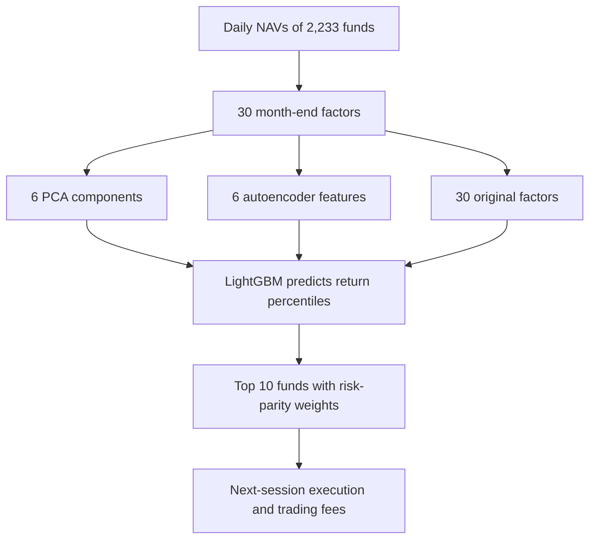
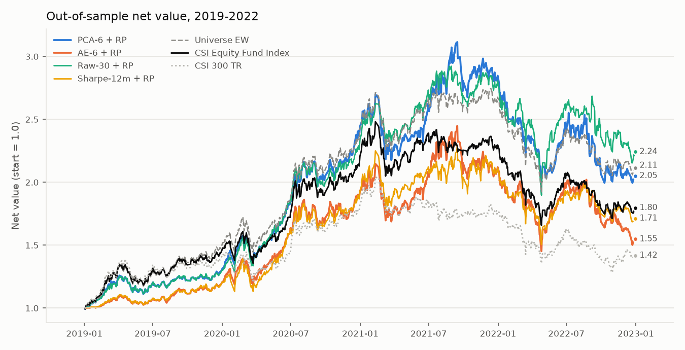
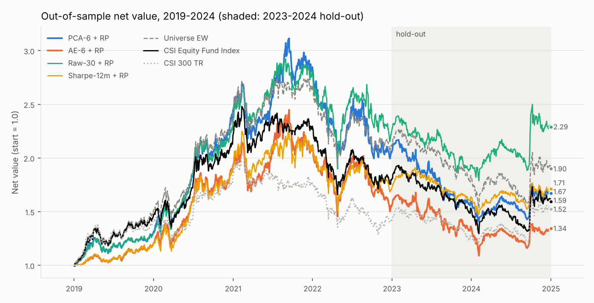
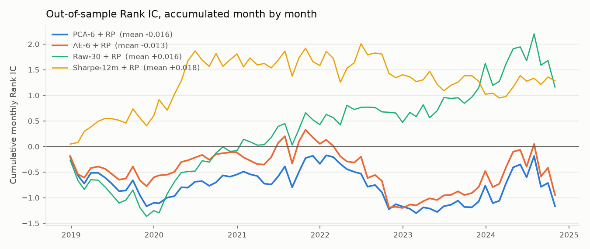

# Rolling Fund Selection

**Can 30 factors derived from fund NAVs rank next month's returns?** This project compares PCA, an
autoencoder and an uncompressed LightGBM model in a walk-forward backtest of Chinese equity funds.
The dataset contains 3,128,021 daily NAV observations. The 2019–2024 backtest draws from 1,866 funds
with recorded NAVs after the fund-type and tradability filters.


Every month-end the pipeline scores every eligible fund, buys the 10 best-ranked funds at the next day's NAV,
sizes them by equal risk contribution and pays realistic subscription/redemption fees:



* **30 NAV-based factors** in five groups: return/momentum, risk, risk-adjusted return, CAPM attribution and
  market timing, consistency. All of them are vectorized across funds in NumPy.
* **Representation:** the factors are compressed to **6 PCA components vs. a 6-unit autoencoder bottleneck**
  (PyTorch), with a raw-30 ablation.
* **Optuna tuning:** LightGBM is tuned on mean validation Rank IC; the autoencoder is tuned on validation
  reconstruction error.
* **Walk-forward validation:** expanding window, yearly retraining. A training sample is used only if its label
  is already known at the cutoff, and a 1-month embargo separates the train and validation folds.
* **Portfolio:** top-10 with a top-20 holding buffer, sized by **risk parity** (equal risk contribution,
  Ledoit-Wolf covariance).
* **Execution realism:** signals at the month-end close, trades at the next day's NAV, 0.15% subscription and
  0.5% redemption fees.
* **Evaluation windows.** The same portfolio settings are used in 2019–2022 and 2023–2024.
  A sensitivity table shows how costs, portfolio size and rebalancing frequency affect the first window.
* **Engineering:** unit tests for the risk-parity solver, drawdown, label timing and the no-look-ahead rule,
  plus an offline test of the downloader and CI.

## Results (out of sample, after fees)

### 2019-2022

| Strategy | CAGR | Excess vs index | Sharpe | Max drawdown | Info ratio | Monthly turnover |
|---|---:|---:|---:|---:|---:|---:|
| **PCA-6 → LightGBM, risk parity** | 20.5% | +4.1 pts | 0.86 | -36.0% | 0.33 | 80.3% |
| **Autoencoder-6 → LightGBM, risk parity** | 12.0% | -4.4 pts | 0.53 | -40.7% | -0.24 | 61.6% |
| Raw 30 factors → LightGBM, risk parity | 23.3% | +6.9 pts | 0.98 | -35.1% | 0.58 | 69.8% |
| Trailing 12m Sharpe rank, risk parity | 15.0% | -1.4 pts | 0.67 | -34.4% | -0.07 | 28.8% |
| PCA-6 → LightGBM, equal weight | 21.8% | +5.4 pts | 0.88 | -38.8% | 0.42 | 79.8% |
| All eligible funds, equal weight | 21.4% | +5.0 pts | 0.97 | -29.9% | 1.63 | 2.7% |
| CSI Equity Fund Index (930950) | 16.4% | — | 0.76 | -33.2% | — | — |
| CSI 300 Total Return | 9.5% | -6.9 pts | 0.47 | -37.2% | -0.84 | — |



### What the numbers say

1. **PCA beat the autoencoder.** PCA-6 + risk parity returned **20.5% a year**, or
   **+4.1 pts** over the CSI Equity Fund Index (16.4%), with a Sharpe of **0.86**.
   The autoencoder variant returned 12.0% (-4.4 pts). The autoencoder reconstructs the
   factors more closely in the first training window (R² of 91.2% for the autoencoder and 89.4% for PCA).
2. **The ranking signal is weak.** Mean monthly out-of-sample Rank IC was -0.026 for PCA,
   -0.025 for the AE and +0.014 for raw-30. Holding all eligible funds at equal weights beat
   the index by 5.0 percentage points, more than the PCA strategy's 4.1 points.
3. **Costs matter.** The model's rankings move a lot month to month: about 80.3% one-way
   turnover per rebalance. The sum of the fees charged at each rebalance was 24.7%, with each fee
   measured against portfolio value at the time. With zero fees PCA-6 would
   have returned 28.4%; with quarterly rebalancing, 24.5%
   (+8.1 pts). These are after-the-fact sensitivity results, not
   headline numbers.
4. **The hold-out changed the ordering.** In 2023–2024 the PCA and AE portfolios lagged the index.
   The raw-30 model, trailing-Sharpe baseline and equal-weight universe all finished ahead of it.

### 2023-2024 hold-out

| Strategy | CAGR | Excess vs index | Sharpe | Max drawdown | Info ratio | Monthly turnover |
|---|---:|---:|---:|---:|---:|---:|
| **PCA-6 → LightGBM, risk parity** | -10.1% | -4.1 pts | -0.60 | -35.0% | -0.39 | 76.6% |
| **Autoencoder-6 → LightGBM, risk parity** | -7.1% | -1.1 pts | -0.36 | -35.1% | -0.07 | 69.2% |
| Raw 30 factors → LightGBM, risk parity | 1.1% | +7.1 pts | 0.07 | -25.3% | 0.77 | 74.7% |
| Trailing 12m Sharpe rank, risk parity | 0.0% | +6.0 pts | -0.05 | -23.0% | 0.47 | 23.0% |
| PCA-6 → LightGBM, equal weight | -13.7% | -7.7 pts | -0.75 | -40.1% | -0.68 | 76.5% |
| All eligible funds, equal weight | -5.4% | +0.6 pts | -0.29 | -32.4% | 0.30 | 1.7% |
| CSI Equity Fund Index (930950) | -6.0% | — | -0.33 | -32.9% | — | — |
| CSI 300 Total Return | 3.8% | +9.8 pts | 0.21 | -22.4% | 1.63 | — |



### Ranking skill (Spearman Rank IC between scores and next-month returns)

| Model | 2019-2022 mean IC | IC > 0 | 2023-2024 mean IC | IC > 0 |
|---|---:|---:|---:|---:|
| PCA-6 → LightGBM | -0.026 | 44.7% | -0.002 | 52.2% |
| Autoencoder-6 → LightGBM | -0.025 | 48.9% | +0.010 | 65.2% |
| Raw 30 factors → LightGBM | +0.014 | 51.1% | +0.022 | 60.9% |
| Trailing 12m Sharpe rank | +0.030 | 57.4% | -0.003 | 56.5% |

Each column includes only holding periods whose entry and exit NAVs fall inside that window.
There are 47 complete periods in 2019–2022, 23 in 2023–2024, and 71 across the full six years.
The December 2022 position exits in January 2023 and appears only in the six-year IC.
Daily portfolio returns include every trading day through the last observed NAV.



### Walk-forward log (one retrain per year)

| Predicts | Training signals | Train rows | PCA var. explained | AE recon. R² | PCA valid IC → OOS IC | AE valid IC → OOS IC |
|---|---|---:|---:|---:|---:|---:|
| 2019 | 2015-12 … 2018-10 | 18,743 | 89.4% | 91.2% | +0.081 → -0.097 | +0.075 → -0.065 |
| 2020 | 2015-12 … 2019-10 | 27,129 | 88.5% | 90.5% | -0.038 → +0.048 | -0.025 → +0.055 |
| 2021 | 2015-12 … 2020-10 | 37,150 | 88.2% | 89.8% | +0.094 → +0.034 | +0.098 → +0.024 |
| 2022 | 2015-12 … 2021-10 | 49,651 | 88.1% | 89.9% | +0.056 → -0.079 | +0.063 → -0.113 |
| 2023 | 2015-12 … 2022-10 | 66,726 | 87.5% | 89.6% | -0.044 → +0.004 | -0.038 → +0.032 |
| 2024 | 2015-12 … 2023-10 | 88,219 | 86.9% | 89.5% | +0.025 → -0.008 | +0.042 → -0.014 |

The validation IC (used by Optuna) rarely carries over to the next year, which is the classic symptom of a
low signal-to-noise problem.

Each annual row groups predictions by the year of entry. The 2024 refit used labels known by the
end of 2023, consistent with the annual retraining rule used in earlier years.

### Sensitivity, 2019-2022 (same model scores, different portfolio settings)

| Setting | PCA-6 CAGR | PCA-6 excess | AE-6 CAGR | AE-6 excess | PCA-6 total costs |
|---|---:|---:|---:|---:|---:|
| baseline: K=10, buffer 20, monthly | 20.5% | +4.1 pts | 12.0% | -4.4 pts | 24.7% |
| K=5 | 23.6% | +7.2 pts | 10.9% | -5.5 pts | 26.7% |
| K=20 | 18.5% | +2.1 pts | 14.1% | -2.3 pts | 22.0% |
| no buffer | 21.0% | +4.6 pts | 12.8% | -3.6 pts | 27.5% |
| quarterly rebalance | 24.5% | +8.1 pts | 14.4% | -2.0 pts | 8.6% |
| zero fees | 28.4% | +12.1 pts | 17.6% | +1.3 pts | 0.0% |
| double fees | 12.9% | -3.5 pts | 6.6% | -9.8 pts | 49.4% |

## Method

**Data.** Daily NAVs (unit NAV, accumulated NAV, dividend-reinvested daily growth rate) for selected Eastmoney
`股票型` (active stock) and `混合型-偏股` (equity-heavy hybrid) fund, keeping one share class per fund:
2,233 funds and 3,128,021 daily rows from 2014-01 to 2024-12. Benchmarks come from
China Securities Index Co.: 930950 CSI Equity Fund Index, 000300 CSI 300 and H00300 CSI 300 TR. Funds with
lock-up or periodic-open structures (持有期 / 定开 / 封闭) are excluded because they cannot be traded monthly,
which leaves 1,870 listed funds, of which 1,866 have NAV data. Month-end eligibility requires
quotes on at least 90% of the past 252 sessions and at least one quote in the past five sessions.
See the [data dictionary](data/README.md).

**Factors** (`src/fundsel/factors.py`), computed from a (days × funds) return window in a single vectorized pass:

| Group | Factors |
|---|---|
| Return / momentum | 1m, 3m, 6m, 12m, 24m return; 12-1 momentum; 6m excess return |
| Risk | 3m and 12m volatility, downside deviation, 6m and 12m max drawdown, CVaR(5%), tracking error |
| Risk-adjusted | 6m and 12m Sharpe, Sortino, Calmar, information ratio |
| Attribution / timing | CAPM alpha, beta, R², residual vol; Treynor-Mazuy γ; up/down capture |
| Consistency | daily win rate vs. benchmark, skewness, kurtosis, distance to 12m high |

Each month the factors are winsorized at 1%/99% and z-scored cross-sectionally (same-day information only).

**Representation** (`reduce.py`). PCA keeps 6 components. The autoencoder is 30 → h → 6 → h → 30 with Tanh, Adam,
mini-batches and early stopping; h ∈ {12, 16, 24}, the learning rate and the weight decay are picked by Optuna.
Both are fit only on the training window.

**Labels and model** (`model.py`). The label is the next month's return as a cross-sectional percentile. A
LightGBM regressor is tuned by Optuna TPE (25 trials per retrain) to maximize the mean validation Rank IC.

**Walk-forward** (`walkforward.py`). The training window expands from 2015-12 and the model is retrained every
January. The last 12 months of the window form the validation fold, separated from the train fold by a
1-month embargo. With the chosen hyperparameters, LightGBM fits all available labeled rows. The
PyTorch autoencoder reserves the last 10% of the historical rows for early stopping during its final
fit. The fitted models then score the next 12 month-ends.

**Portfolio and backtest** (`portfolio.py`, `backtest.py`). Each month the 10 highest-scored funds are selected;
a current holding is kept while it still ranks inside the top 20. Weights are equal risk contributions from a
Ledoit-Wolf covariance of the last 126 days. Signals are formed at the month-end close and trades fill at the
next trading day's NAV. Weights drift between rebalances. Subscription fee 0.15%, redemption fee 0.5%,
risk-free rate 1.5%.

## Reproduce

```bash
python -m pip install -r requirements.txt
python -m pytest tests/ -q
python run_pipeline.py --quick --out-dir outputs/quick   # fewer tuning trials on the bundled data
python run_pipeline.py --out-dir outputs/full            # full experiment
```

The dataset in [data/raw/](data/raw/) is included. Both runs use it directly. The checked-in
[results](results/) contain the reference run, including dated holdings, daily portfolio NAVs and
the tuning log. The search budget and numerical-library versions can affect the fitted models.
To refresh inputs from the providers, install `akshare` and `requests`, then run
`python scripts/download_data.py`.

## Repository layout

```
run_pipeline.py              end-to-end run -> results/
src/fundsel/
  config.py                  every parameter in one dataclass
  data.py                    NAV -> daily return matrix, trading calendar, forward-return labels
  factors.py                 the 30 factors (vectorized) + cross-sectional standardization
  reduce.py                  PCA / PyTorch autoencoder / identity
  model.py                   LightGBM + Optuna, Rank IC
  walkforward.py             expanding-window retraining with label-availability purge and embargo
  portfolio.py               top-K with buffer, Ledoit-Wolf covariance, risk-parity solver
  backtest.py                daily simulation with T+1 execution, weight drift and fees
  metrics.py, sensitivity.py, plots.py
scripts/download_data.py     data download (Eastmoney + China Securities Index Co. via AkShare)
scripts/browser/             the same download as browser scripts (used to build data/raw/), plus a converter
tests/                       unit tests, offline downloader test, synthetic-data generator
data/raw/                    the dataset used for every number above
results/                     metrics, IC, sensitivity, holdings, walk-forward log, figures
```

## Limitations

* **Survivorship bias.** Eastmoney's fund list only contains funds that still exist, so funds liquidated between
  2015 and 2024 are missing. This flatters the fund universe (and the equal-weight reference) relative to the
  official index, which included those funds at the time.
* **Current classification.** Fund types are Eastmoney's current labels, not point-in-time ones.
* **Tradability.** The backtest ignores purchase limits on popular funds and the T+2 to T+4 settlement of
  redemptions.
* **NAV-only factors.** Holdings, fund size and manager changes are not used, because public sources do not keep
  point-in-time history for them.
* **One configuration, one seed.** The headline results use one portfolio configuration and random seed 42.

## Data and license

The MIT license covers the code. Fund NAVs are sourced from Eastmoney and benchmark levels from
China Securities Index Co. The providers retain their respective data rights. See the [data notes](data/README.md).
